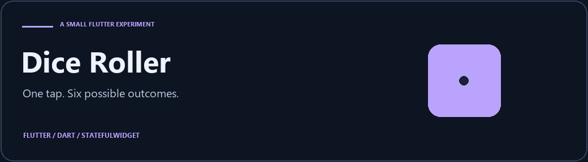

<div align="center">



# Dice Roller

**One tap. Six possible outcomes.**


[Overview](#overview) &nbsp; · &nbsp; [Run locally](#run-locally) &nbsp; · &nbsp; [Explore the repository](https://github.com/mcampo0215/dice_roller)

</div>

---

## Overview

A focused Flutter app that displays a die on a gradient background. Tap **Roll the Dice** to generate a new value from 1 to 6 and update the matching image.

| Roll | Update | Customize |
| :--- | :--- | :--- |
| Generate a die value with Dart’s Random class. | Rebuild the image using StatefulWidget and setState. | Change the background gradient, assets, or button styling. |

## Run locally

Use Flutter with Dart compatible with `^3.10.4` from `pubspec.yaml`, plus the toolchain for your chosen target:

```sh
flutter pub get
flutter devices
flutter run
```

## Explore the code

| Source | Responsibility |
| :--- | :--- |
| [lib/main.dart](lib/main.dart) | App entry point. |
| [lib/gradient_container.dart](lib/gradient_container.dart) | Gradient layout. |
| [lib/dice_roller.dart](lib/dice_roller.dart) | Current die value, random selection, image, and roll button. |
| [assets/images/](assets/images/) | Six die-face images. |

The die starts at 2. Each tap samples `Random().nextInt(6) + 1`; consecutive rolls can have the same result. State lives in memory, with no account, backend, or roll-history database.

The animated README banner is an illustration; the app itself changes the die image immediately when tapped.

## Development

```sh
flutter analyze
flutter test
```

Review the existing starter test against the current UI before treating it as app coverage.

---

<p align="center"><a href="#dice-roller">Back to the top</a></p>
